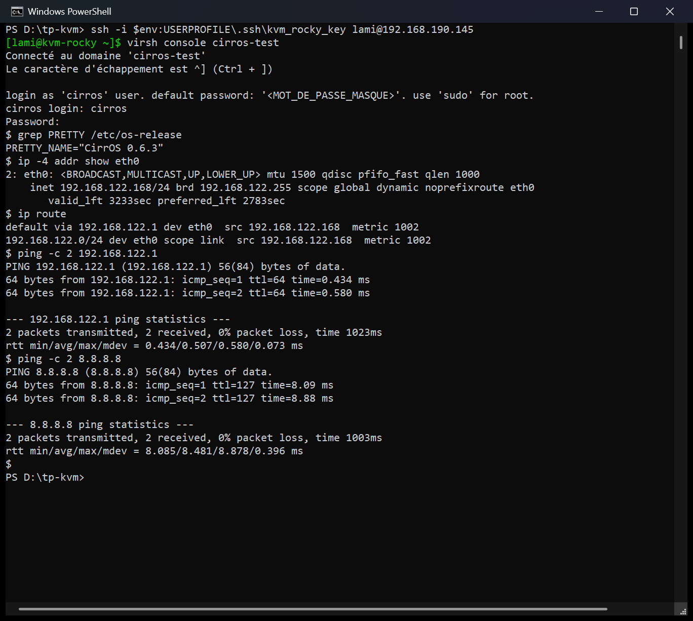

# 🖥️ Transformer un serveur Rocky Linux en hyperviseur KVM


> **En une phrase :** j'ai installé un serveur **Rocky Linux 9.8** (le clone gratuit de Red Hat) et, **pendant l'installation**, je l'ai transformé en **hyperviseur KVM**. Ensuite, j'y ai fait tourner une petite machine virtuelle (**CirrOS**) qui a accès à Internet.

Ce dépôt est écrit pour être compris **même sans rien connaître** à KVM. Tous les mots techniques sont expliqués.
👉 **Le cours complet**, étape par étape, pour **tout refaire de zéro** : [`docs/compte-rendu.md`](docs/compte-rendu.md)
👉 **Réviser pour l'oral** : [`docs/fiche-questions-oral.md`](docs/fiche-questions-oral.md)

> Projet réalisé pendant la semaine de formation **Virtualisation** (TP 3), après les TP **VMware ESXi** et **OpenStack**.
> Consigne : documentation Red Hat *« Installing KVM with a new Red Hat Enterprise Linux installation »*.

---

## 📖 Les mots à connaître

| Mot | Explication simple |
|---|---|
| **VM (machine virtuelle)** | un faux ordinateur, simulé par un logiciel, qui tourne dans un vrai ordinateur |
| **Hyperviseur** | le logiciel qui fait tourner les VM (ESXi, KVM, VMware Workstation…) |
| **KVM** | un morceau du noyau Linux qui transforme Linux en hyperviseur. 🚗 C'est le **moteur**. |
| **QEMU** | fabrique le faux matériel des VM (disque, réseau…). 🚗 C'est la **carrosserie**. |
| **libvirt** | le service qui gère toutes les VM. 🚗 C'est le **garagiste**. |
| **virsh / virt-install** | les commandes pour parler à libvirt / pour créer une VM |
| **Rocky Linux** | la copie gratuite de **RHEL** (Red Hat Enterprise Linux), le Linux des entreprises |
| **Kickstart** | un fichier de réponses qui installe Rocky **tout seul**, sans clic |
| **« Hôte de virtualisation »** | le profil choisi pendant l'installation qui ajoute KVM |
| **VT-x** | le « turbo » du processeur pour la virtualisation |
| **Émulation (TCG)** | sans turbo, QEMU imite le processeur par logiciel : ça marche, mais c'est plus lent |
| **CirrOS** | un Linux minuscule (21 Mo), fait pour tester les hyperviseurs |

---

## 🎯 Résultat : ça marche !

| Test | Résultat | Ce que ça prouve |
|---|---|---|
| Installation automatique (kickstart) | ✅ environ 12 min, aucun clic | Anaconda a trouvé le fichier de réponses tout seul |
| `dnf group list --installed` | ✅ « Hôte de virtualisation » | KVM a été installé **pendant** l'installation |
| `rpm -q` | ✅ `qemu-kvm 10.1.0`, `libvirt 11.10.0`, `virt-install 5.1.0` | toute la pile KVM est là |
| `systemctl status virtqemud` | ✅ `active (running)` | le gestionnaire de VM fonctionne |
| `virsh net-list` | ✅ réseau `default` actif | les VM ont un réseau (switch `virbr0`) |
| `virt-install` + `virsh list` | ✅ `cirros-test` en cours d'exécution | KVM/QEMU fait tourner une VM |
| `ping` Rocky → CirrOS | ✅ 0 % de perte | la VM est joignable |
| Console CirrOS → `ping 8.8.8.8` | ✅ 0 % de perte | la VM sort sur Internet |
| `virt-host-validate` | ⚠️ pas de VT-x → émulation | choix assumé : Windows garde VT-x pour sa sécurité |



*Sur cette capture, on est **dans** CirrOS, qui tourne dans KVM, qui tourne dans Rocky, qui tourne dans VMware. CirrOS a l'IP `192.168.122.168` et joint Internet.*

---

## 🏗️ Comment c'est construit

```
 PC Windows 11 (VMware Workstation 25)
 └── Réseau NAT VMware « VMnet8 » : 192.168.190.0/24
      └── VM « kvm-rocky » : Rocky Linux 9.8 + KVM (4 processeurs, 8 Go de RAM, 60 Go de disque)
           ├── carte ens160 : 192.168.190.145   → pour s'y connecter en SSH depuis Windows
           └── switch virtuel virbr0 : 192.168.122.1   (réseau libvirt « default » : DHCP + NAT)
                └── VM « cirros-test » : CirrOS 0.6.3 (1 processeur, 256 Mo)
                     └── carte eth0 : 192.168.122.168
```

---

## 💡 Les 4 idées clés

**1. « Installer KVM pendant l'installation », c'est quoi ?**
C'est choisir le profil **« Hôte de virtualisation »** au moment d'installer Rocky. Dans le kickstart, c'est une seule ligne : `@^virtualization-host-environment`.

**2. Comment l'installation s'est faite toute seule ?**
Le fichier de réponses `ks.cfg` était sur un petit CD virtuel nommé **`OEMDRV`**. L'installateur (Anaconda) cherche automatiquement ce nom au démarrage.

**3. Pourquoi l'émulation et pas le turbo KVM ?**
KVM est rapide grâce à **VT-x**. Mais Windows 11 garde VT-x pour sa **sécurité** (VBS, Windows Hello). On a choisi de **ne pas** baisser la sécurité du PC. Les VM tournent donc en **émulation** (`--virt-type qemu`), comme dans le TP OpenStack.

**4. À quoi ça sert en entreprise ?**
KVM est **gratuit** et tourne sous le capot de **Proxmox VE**, d'**OpenStack**, de **Google Cloud** et de l'hyperviseur **Nitro d'AWS**. Depuis le rachat de VMware par Broadcom (licences devenues des abonnements), beaucoup d'entreprises regardent vers KVM.

---

## 📁 Ce qu'il y a dans ce dépôt

```
.
├── README.md                    ← tu es ici (la vitrine)
├── HACKMD.md                    ← le cours complet, version HackMD
├── docs/
│   ├── compte-rendu.md          ← 📚 le cours complet, pour tout refaire de zéro
│   └── fiche-questions-oral.md  ← 19 questions/réponses pour réviser
├── config/
│   ├── ks-publiable.cfg         ← le kickstart (mot de passe masqué)
│   ├── make-oemdrv-iso.ps1      ← fabrique le CD « OEMDRV »
│   ├── kvm-rocky.vmx            ← la fiche technique de la VM VMware
│   └── ...                      ← scripts d'automatisation et de capture (voir l'annexe du cours)
├── captures/                    ← les captures d'écran, numérotées dans l'ordre du TP
└── logs/                        ← les sorties brutes de toutes les commandes
```

---

## 🛠️ Les problèmes rencontrés (en bref)

| Problème | Pourquoi | Solution |
|---|---|---|
| `virt-host-validate` : « hardware virtualization : ÉCHEC » | pas de VT-x dans la VM (Windows le garde) | émulation : `--virt-type qemu` |
| `virsh` : « aucun agent polkit disponible » | lami n'avait pas le droit de gérer les VM | `sudo usermod -aG libvirt lami`, puis reconnexion |
| CirrOS 0.6.3 inconnu de `osinfo-query` | la base de systèmes est plus ancienne | `--os-variant cirros0.5.2` (le plus proche) |
| CirrOS met 3 à 4 minutes à démarrer | l'émulation est lente | patience 🙂 |

Tous les détails sont dans le [cours complet](docs/compte-rendu.md#19-problèmes-rencontrés-et-solutions).

---

## 🔒 Sécurité : ce qui n'est PAS dans ce dépôt

| Élément | Pourquoi |
|---|---|
| `config/ks.cfg` | il contient le **hash** du mot de passe (version publiée : `ks-publiable.cfg`) |
| la clé **privée** SSH | elle ouvre le serveur : elle reste sur le PC |
| les ISO et disques `.vmdk` | trop gros et inutiles sur GitHub |

Aucune capture ne montre de mot de passe. Le mot de passe par défaut de CirrOS est masqué.

---

## 🧠 Les 5 choses à retenir

1. **KVM** = le moteur, **QEMU** = la carrosserie, **libvirt** = le garagiste, **virsh** = son téléphone.
2. Installer KVM pendant l'installation = choisir **« Hôte de virtualisation »**.
3. Un **kickstart** installe tout seul ; Anaconda le trouve sur un CD nommé **OEMDRV**.
4. Sans **VT-x**, KVM ne peut pas accélérer : QEMU **émule** (`--virt-type qemu`).
5. **OpenStack, Proxmox et Google Cloud reposent sur KVM** : ce TP montre la brique du dessous.

---

## 📚 Pour aller plus loin

- [Documentation Rocky Linux](https://docs.rockylinux.org/)
- [Documentation Red Hat – Virtualisation (RHEL 9)](https://docs.redhat.com/en/documentation/red_hat_enterprise_linux/9/html/configuring_and_managing_virtualization/index)
- [Référence des commandes kickstart](https://pykickstart.readthedocs.io/)
- [libvirt](https://libvirt.org/) · [CirrOS](https://download.cirros-cloud.net/)

---

**Auteur :** Lami ([@L4ami](https://github.com/L4ami)) · Octobre 2026
